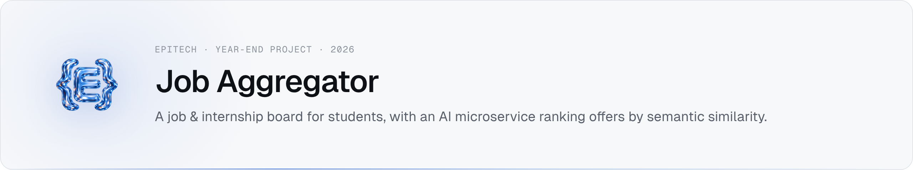

<picture><source media="(prefers-color-scheme: dark)" srcset="assets/banner-dark.png"></picture>

**Epitech Bachelor · Year 1 · Year-End Project (B-YEP-200) · Apr–May 2026**
Source code is private under Epitech's academic policy. Happy to walk you through it or demo it live → **imran.nogueira@gmail.com**

## Overview

A fullstack platform that collects job and internship offers, normalizes them into a single schema and lets students search, filter and save them. On top of keyword filters, a dedicated AI service ranks offers against a natural-language query such as *"Stage Python Paris backend"*. Offers older than 60 days are flagged as likely **ghost jobs**.

## Stack

| Layer | Tech |
|---|---|
| Frontend | Next.js, React, TypeScript, Tailwind CSS |
| Backend API | Node.js, Express, TypeScript, Zod validation, JWT + bcrypt, express-rate-limit, Nodemailer |
| AI service | Python, FastAPI, sentence-transformers (`all-MiniLM-L6-v2`), NumPy |
| Data | PostgreSQL 15 |
| Quality | Jest + Supertest, ESLint, GitHub Actions CI (lint + tests) |
| Infra | Docker Compose (frontend, backend, AI service, database, Adminer) |

## How it works

```
Next.js ──HTTP──▶ Express API ──SQL──▶ PostgreSQL
                       │                    ▲
                       └──/score──▶ FastAPI AI service (embeddings stored per offer)
```

1. `/compute-embeddings` encodes each offer's title + description once (384-dim vectors) and stores them in PostgreSQL.
2. `/score` encodes the user's query, computes cosine similarity against every stored offer and returns the top matches.
3. Scores are spread with a square root (a 0.5 similarity becomes 70/100 instead of 50) and boosted ×1.3 when the query mentions the offer's location.

## Key decisions

- **Embeddings in PostgreSQL, no vector database** — at this data size a `bytea` column plus NumPy is enough, and it saves a whole service to run.
- **AI as a separate container** — the 80 MB model loads once at startup and the Node API stays lightweight.
- **Decisions written down** — the project ships Architecture Decision Records for architecture, data & AI, security, CI, deployment and accessibility, plus a sourced market scan and a value proposition.

## Results

- 25 backend tests (normalizer unit tests + API route tests) running in CI.

## Contact

Code walkthrough or live demo on request → **imran.nogueira@gmail.com** · [Portfolio](https://imran-nogueira.github.io)
